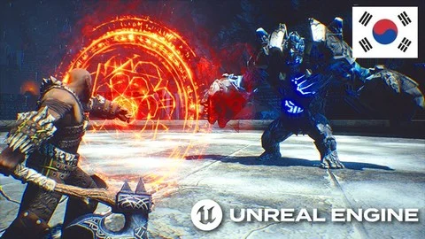

# [Unreal Engine 5 C++: 고급 액션 RPG 구축하기!](https://www.udemy.com/course/unreal-engine-5-advanced-action-rpg-korean/?couponCode=MT261012G1)

## 배울 내용
- 강력한 melee 콤보 시스템(가벼운 공격과 강한 공격 포함)
- Gameplay Ability System을 활용하여 몰입감 있는 RPG 전투 경험 제공
- 커스텀 BTTask, BTTDecorator, BTService를 사용한 고급 적 AI
- 고급 AI 행동을 위한 환경 쿼리 시스템
- 방향성 히트 반응 및 롤링
- Melee 블록 및 parry 시스템
- 특수 무기 능력과 분노 능력(비용 및 쿨다운 포함)
- 강력한 UI 알림 시스템
- 적이 웨이브로 생성되는 생존 전투 게임 모드
- 메인 메뉴, 일시 정지 메뉴, 승리/패배 화면 및 로딩 화면
- 효율적인 타겟 잠금 시스템
- 근접 및 원거리 능력을 가진 다양한 종류의 적
- 전투를 위한 커스텀 C++ 능력 작업/지연 액션
- BP와 C++에서 비동기적 및 동기적 로딩을 사용하는 모범 사례
- 데이터 중심의 전투 통계 설계
- 산업 표준 코드 관행 및 쉽게 확장 가능한 코드 구조

## [내용 정리 노션 페이지](https://coal-schooner-81d.notion.site/Unreal-Engine-5-C-RPG-39524bba9b04809e8db6d09a21d60e35?source=copy_link)
